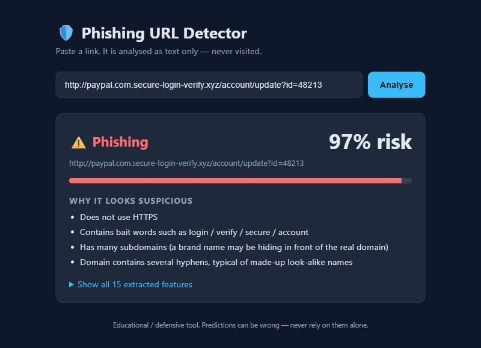

# 🛡️ Assas – AI-Powered Phishing URL Detector

[](https://www.python.org/)
[](LICENSE)

> ⚠️ **Defensive / educational use only.** Assas analyses URLs as text and never visits or attacks anything.

A small, defensive cybersecurity project: you paste a URL, a machine-learning model
(RandomForest, scikit-learn) classifies it as **Phishing** or **Legitimate**, gives a
**risk score (0–100 %)** and lists the **top reasons** behind the decision.

The URL is analysed **purely as text**. The tool never opens, downloads or contacts the link.

## Results on real data

Trained on **821,384 real URLs** (386k phishing / 435k legitimate) from the open
[ealvaradob/phishing-dataset](https://huggingface.co/datasets/ealvaradob/phishing-dataset)
(Apache-2.0; compiled from PhishTank, OpenPhish, JPCERT and other public feeds).
Evaluated on a held-out 20 % test set of **164,277 URLs** the model never saw:

| Metric | Score | Meaning |
|---|---|---|
| Accuracy | **90.5 %** | share of all URLs classified correctly |
| Precision | **93.4 %** | of URLs flagged as phishing, how many really were |
| Recall | **85.9 %** | of real phishing URLs, how many were caught |
| F1 (phishing) | **89.5 %** | balance of precision and recall |

```
Confusion matrix        pred Legit   pred Phish
true Legitimate             82,341        4,701
true Phishing               10,869       66,366
```

Top features by importance: `path_depth`, `url_length`, `hostname_length`, `uses_https`,
`num_digits`, `num_suspicious_words`. Model: RandomForest, 150 trees, max depth 24,
15 string-only features. Saved model: `model/phishing_model.joblib` (58 MB, included).

## Screenshot



## Quick start

```bash
git clone https://github.com/jm3ax0/Assas.git
cd Assas
pip install -r requirements.txt
python app/app.py
```
Then open <http://127.0.0.1:5000> in your browser, paste a URL and press **Analyse**.
A trained model is already included, so no training is needed. Full details below.

## Project structure

```
Assas/
├── app/                  Flask web interface
│   ├── app.py
│   └── templates/index.html
├── data/
│   ├── make_sample_data.py   generates a small demo dataset (sample_urls.csv)
│   ├── convert_hf_dataset.py converts the Hugging Face dataset into urls.csv
│   └── urls.csv              real dataset, 821k rows (not in git, see section 4)
├── features/
│   └── extract.py        turns a URL string into 15 numeric features
├── model/
│   ├── train.py          trains, evaluates and saves the model
│   └── phishing_model.joblib   (created by train.py)
├── requirements.txt
├── LICENSE
├── SECURITY.md
└── README.md
```

## 1. Setup (Windows / macOS / Linux)

```bash
git clone https://github.com/jm3ax0/Assas.git
cd Assas
python -m venv .venv
```
Activate the virtual environment:
- Windows PowerShell: `.venv\Scripts\Activate.ps1`
- macOS / Linux: `source .venv/bin/activate`

```bash
pip install -r requirements.txt
```

## 2. Train the model (optional – a trained model is already included)

```bash
python model/train.py
```
This prints accuracy, precision, recall, F1, the confusion matrix and the feature
importances, then saves `model/phishing_model.joblib`. Training on the full 821k
dataset takes a few minutes on a laptop.

If `data/urls.csv` does not exist the script generates and uses `data/sample_urls.csv`
(800 synthetic rows). **Numbers from the sample are only a demo** – get the real
dataset as described in section 4.

## 3. Run the web app

From the project root (with the virtual environment activated):

```bash
python app/app.py
```
1. Wait for `Running on http://127.0.0.1:5000`.
2. Open <http://127.0.0.1:5000> in your browser.
3. Paste a URL and press **Analyse**. The card shows the verdict, the risk score and the
   top reasons; *Show all extracted features* lists the 15 raw feature values.
4. Stop the server with `Ctrl+C`.

The server only listens on your own machine (`127.0.0.1`) and is meant for local use.

There is also a JSON API:
```bash
curl -X POST http://127.0.0.1:5000/api/check -H "Content-Type: application/json" -d "{\"url\": \"http://paypal.com.verify-login.xyz\"}"
```

## 4. Getting the real dataset

`data/urls.csv` (40 MB) is not committed to git. To recreate it:

1. Download `urls.json` (70 MB, no login needed) from
   <https://huggingface.co/datasets/ealvaradob/phishing-dataset/resolve/main/urls.json>
2. Convert it:
   ```bash
   python data/convert_hf_dataset.py path/to/urls.json
   ```
3. Retrain: `python model/train.py`

Any other CSV with columns `url,label` (label = `1`/`phishing`/`bad` or
`0`/`legitimate`/`good`) saved as `data/urls.csv` works too. Other open datasets:

| Dataset | Link |
|---|---|
| Hugging Face – pirocheto/phishing-url (11k, academic) | https://huggingface.co/datasets/pirocheto/phishing-url |
| Kaggle – Phishing Site URLs | https://www.kaggle.com/datasets/taruntiwarihp/phishing-site-urls |
| Kaggle – Malicious URLs | https://www.kaggle.com/datasets/sid321axn/malicious-urls-dataset |
| PhishTank verified feed | https://phishtank.org/developer_info.php |
| UCI Phishing Websites | https://archive.ics.uci.edu/dataset/327/phishing+websites (already-extracted features, different format) |

## 5. How it works

1. **Feature extraction** – a computer cannot "read" a URL, so `features/extract.py`
   measures 15 facts about it: length, number of dots, hyphens and digits, presence of
   `@`, an IP address instead of a name, number of subdomains, HTTPS or not, bait words
   (`login`, `verify`, `bank`…), URL shorteners, suspicious TLDs, query parameters, path depth.
   Every URL becomes a row of 15 numbers.

2. **Supervised learning** – we have thousands of URLs already labelled by humans
   (1 = phishing, 0 = legitimate). The model's job is to find patterns that separate the two.

3. **RandomForest** – the model is a *forest* of 150 *decision trees*. One decision tree is
   a chain of yes/no questions learned from the data, e.g. *"Is there an `@`? → Are there
   more than 2 subdomains? → Is the TLD `.xyz`?"*. Each tree is trained on a different
   random slice of the data and a random subset of features, so each one makes different
   mistakes. To classify a new URL, all 150 trees vote. The share of trees voting
   "phishing" is the **risk score** (e.g. 135/150 → 90 %). The majority wins.

4. **Evaluation** – we keep 20 % of the data hidden during training and test on it.
   *Accuracy* = how many we got right overall; *Precision* = of the URLs we flagged, how
   many really were phishing (false alarms); *Recall* = of all real phishing URLs, how many
   we caught (misses). The confusion matrix shows these four numbers.

5. **Explanation** – RandomForest tells us which features mattered most (*feature
   importance*). The app uses that ranking to show the top reasons for each verdict.

**Limitations:** the model only sees the URL string, so a phishing page hosted on a clean,
short domain (or on a hacked legitimate site) can slip through. It is one layer of
defence, not a replacement for browser protection, DNS filtering or user training.

## 6. Ethics & responsible use

- This tool is for **defensive and educational purposes only**.
- It analyses URLs **as text** and **never visits, scans, probes or attacks** any website.
- Predictions are probabilistic and can be wrong (false positives and false negatives).
  Do not use a single verdict as proof that a site is safe or malicious.
- Do not use it to harass site owners or to make automated blocking decisions without human review.
- Datasets used must be public and licensed for research/educational use.

See [SECURITY.md](SECURITY.md) to report a vulnerability.

## License

[MIT](LICENSE) © 2026 jm3ax0
